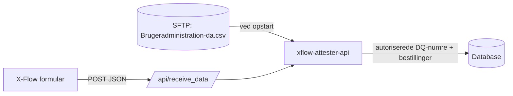
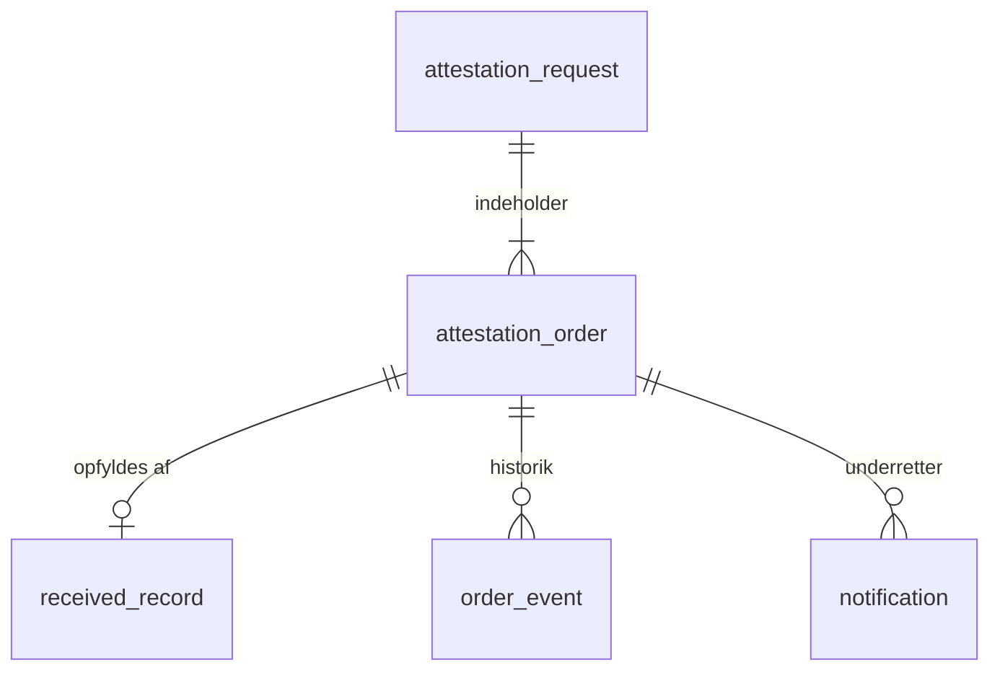

# xflow-attester-api
[**Formål**](#formål) | [**Beskrivelse**](#beskrivelse) | [**Features**](#features) | [**Afhængigheder**](#afh%C3%A6ngigheder)

# Formål

API der modtager attestbestillinger (straffeattest, børneattest m.fl.) fra X-Flow, validerer dem, kontrollerer at rekvirenten er leder/stedfortræder og gemmer bestillingen i databasen.

## Beskrivelse



1. **Ved opstart** hentes `/Brugeradministration-da.csv` (semikolon-separeret, UTF-16) fra SFTP. DQ-numre med rollen *Leder* eller *Stedfortræder for leder* gemmes med deres rolle i tabellen `authorized_sagsbehandler` (listen erstattes hver gang). Kan SFTP ikke nås, starter app'en ikke.
2. **Ved modtagelse** valideres JSON, og rekvirentens DQ-nummer slås op. Der oprettes **én række** i `attestation_request` og **én række pr. bestilt attestType** i `attestation_order`, hver med en første statushændelse i `order_event` og en afventende underretning i `notification`.
3. Bestillinger fra ikke-autoriserede rekvirenter gemmes også, men med `is_approved = false` og ordrestatus `rejected`. Der oprettes en `order_rejection` i stedet for en `order_confirmation` pr. ordre.

> Data indeholder CPR-numre (personfølsomme oplysninger). Brug aldrig produktionsdata i test, og log ikke payloads.

## Features

| Metode | Sti | Beskrivelse |
|---|---|---|
| POST | `/api/receive_data` | Modtager bestilling fra X-Flow |
| GET | `/healthz` | Health check – returnerer `{"status": "ok"}` |
| GET | `/metrics` | Prometheus metrics (bl.a. `http_server_errors_total` og `error_count_total{error_type="db|sftp|python"}`) |

### POST /api/receive_data

```json
{
    "sagsbehandler": "Fornavn Efternavn - DQ12345",
    "medarbejderCPR": "010190-1234",
    "attestType": "0, 1, 2",
    "attestSubType": [
        {"attestType": 0, "subType": 3},
        {"attestType": 2, "subType": 1}
    ],
    "samtykke": true
}
```

Valideringsregler:

* `sagsbehandler`: `Navn - DQ-nummer` (DQ-nummerets format valideres ikke).
* `medarbejderCPR`: `DDMMÅÅ-XXXX` eller `DDMMÅÅXXXX`. Gemmes altid uden bindestreg.
* `attestType`: `0`, `1` og/eller `2` – int eller kommasepareret string, ingen dubletter.
* `attestSubType`: præcis ét objekt for hver bestilt attestType 0 og 2. AttestType 1 har ingen subtype (`[]` hvis kun 1 er bestilt).
* `samtykke`: boolean.

Svar:

* `200` – `{"status": "data received", "approvalStatus": "approved" | "denied", "requestId": "<uuid>"}`
* `400` – `{"errors": [...]}` ved valideringsfejl
* `503` – database ikke konfigureret

### Databasestruktur

Modellerne er defineret i [`src/model.py`](/src/model.py). Denne app skriver til `authorized_sagsbehandler`, `attestation_request`, `attestation_order`, `order_event` og `notification`. `received_record` udfyldes af den app, der modtager og journaliserer attesterne.



| Tabel | Indhold | Felter |
|---|---|---|
| `authorized_sagsbehandler` | Ledere/stedfortrædere fra CSV'en | `dq_number` (PK), `role` (`leder` / `stedfortraeder for leder`) |
| `attestation_request` | Én række pr. modtaget formular | `request_id` (PK, returneres som `requestId`), `requester_dq`, `requester_name`, `subject_cpr`, `is_approved`, `requested_at` |
| `attestation_order` | Én række pr. bestilt attestType. Unik på (`request_id`, `attest_type`) | `order_id` (PK), `request_id` (FK), `attest_type`, `attest_subtype`, `status`, `external_order_ref`, `ordered_at` |
| `received_record` | Modtaget attest og hvordan den er behandlet | `record_id` (PK), `order_id` (FK, unik, tom indtil matchet), `external_ref`, `received_at`, `outcome`, `processed_at`, `sbsys_sags_nr`, `sbsys_sags_id`, `sbsys_document_id` |
| `order_event` | Logbog over statusændringer pr. ordre (der tilføjes kun rækker) | `event_id` (PK), `order_id` (FK), `status`, `occurred_at`, `actor` |
| `notification` | Underretninger til rekvirenten pr. ordre. Unik på (`order_id`, `notification_type`) | `notification_id` (PK), `order_id` (FK), `notification_type`, `status`, `attempts`, `created_at`, `sent_at`, `last_error` |

Ordrestatus (`status`): `pending_order`, `ordered`, `received`, `journalized`, `sent_to_requester`, `rejected`. Nye ordrer får `pending_order`, hvis rekvirenten er autoriseret, ellers `rejected`.

En modtaget attest behandles på én af to måder, angivet i `received_record.outcome`:

* `journalized` – attesten er journaliseret automatisk i SBSYS. Det sker kun, når det er sikkert, hvilken sag den hører til. `sbsys_*`-felterne er udfyldt.
* `sent_to_requester` – attesten er sendt til den sagsbehandler, der bestilte den, som så journaliserer den manuelt. `sbsys_*`-felterne er tomme.

`outcome` og `processed_at` er tomme, indtil attesten er behandlet, og skal udfyldes samtidig.

Underretninger spores i `notification` og påvirker ikke ordrestatus. Ordrestatus viser, hvor langt ordren er nået, og `notification.status` (`pending`, `sent`, `failed`) viser, om underretningen er sendt. Denne app opretter én `pending` underretning pr. ordre, men sender ikke mails. En anden app sender de afventende underretninger på en tidsplan:

* `order_confirmation` – bekræftelse på, at bestillingen er modtaget.
* `order_rejection` – besked om, at bestillingen er afvist.
* `record_journalized` – mail med link til den journaliserede attest.
* `record_sent_to_requester` – mail med attesten vedhæftet til manuel journalisering.

Kun `order_confirmation` og `order_rejection` oprettes af denne app; underretninger om modtagne attester håndteres af en anden app.

`last_error` må ikke indeholde personoplysninger.

Manglende tabeller oprettes automatisk ved opstart. Eksisterende tabeller ændres ikke, og de gamle tabeller `attestation_requests` og `authorized_sagsbehandler` bruges ikke længere og migreres ikke automatisk.

### Kendte begrænsninger / TODO

* Autorisationslisten opdateres kun ved opstart.
* En anden app skal sende de oprettede underretninger; dette API udsender ingen mails.

## Afhængigheder

:cloud: | API'er, FTP-servere, CDN'er andre online services som applikationen kommunikerer med.

* SFTP-server (SFTP-SDRoller) med `Brugeradministration-da.csv`
* Database: MSSQL ([pymssql](https://pypi.org/project/pymssql/)) eller PostgreSQL ([psycopg2](https://pypi.org/project/psycopg2-binary/)) via [SQLAlchemy](https://www.sqlalchemy.org/) og `DatabaseManager` fra [rk-digi](https://github.com/Randers-Kommune-Digitalisering/rk-digi-package)

:heavy_dollar_sign: | Miljøvariabler som forventes at være udfyldt. Secrets ligger i Bitwarden; lokalt lægges de i `.env` (git-ignored, se `.env.example`).

| Variabel | Beskrivelse |
|---|---|
| `FLASK_ENV` | `dev` eller `prod` (default `dev`, som har `DEBUG=True` som default) |
| `DEBUG` | `True`/`False` |
| `PORT` | Port app'en lytter på (default `8080`) |
| `ATTEST_DB_TYPE` | `mssql` eller `postgres` (`postgresql` accepteres også; default `mssql`) |
| `ATTEST_DB_HOST` / `ATTEST_DB_PORT` | Database server |
| `ATTEST_DB_NAME` | Databasenavn |
| `ATTEST_DB_USERNAME` / `ATTEST_DB_PASSWORD` | Database login |
| `SFTP_HOST` / `SFTP_USERNAME` | SFTP server |
| `SFTP_HOST_KEY` | SFTP-serverens host key som `<key-type> <base64>`. Påkrævet – forbindelsen afvises ved mismatch. Se [SFTP host key](#sftp-host-key) |
| `SFTP_PASSWORD` | SFTP kodeord – eller brug nøgle herunder |

### SFTP host key

App'en stoler kun på den host key, der er angivet i `SFTP_HOST_KEY`. Hent nøglen med `ssh-keyscan` (findes i OpenSSH på både Linux/macOS og Windows):

```bash
ssh-keyscan -t ed25519 sftp.randers.dk
```

Outputtet har formatet `<host> <key-type> <base64>`, fx:

```text
sftp.randers.dk ssh-ed25519 AAAAC3NzaC1lZDI1NTE5AAAA...
```

Sæt `SFTP_HOST_KEY` til alt **efter** hostnavnet:

```bash
SFTP_HOST_KEY=ssh-ed25519 AAAAC3NzaC1lZDI1NTE5AAAA...
```

Verificér nøglen, før den tages i brug. `ssh-keyscan` kan selv blive udsat for man-in-the-middle, så sammenlign fingerprintet med det, driftsansvarlig for SFTP-serveren oplyser via en anden kanal:

```bash
ssh-keyscan -t ed25519 sftp.randers.dk | ssh-keygen -lf -
```

Hvis serverens host key udskiftes, skal `SFTP_HOST_KEY` opdateres (lokalt i `.env` og i Bitwarden/deployment-secrets), ellers starter app'en ikke.

## Udvikling

<!--
Beskrivelse af hvordan løsningen startes lokalt.
Overblik over eventuelle API endpoints som løsningen udstiller.
Notering af eventuelle hard-codede værdier, og hvordan værdierne kan ændres.
-->

### Lokal udvikling

1) Opret et virtuelt miljø:

    *Linux/macOS*:

    ```bash
    python -m venv .venv
    source .venv/bin/activate
    ```

    *Windows (PowerShell)*:

    ```powershell
    python -m venv .venv
    .\.venv\Scripts\Activate.ps1
    ```

2) Installér dependencies:

    ```bash
    pip install -r requirements.txt -r requirements-dev.txt 
    ```

3) Opret din `.env` (hvis denne mangler)

    Kopiér eksempel-filen, og redigér værdier efter behov.

    ```bash
    cp .env.example .env
    ```

    Bemærk:

    - `.env` ignoreres af git.
    - `SFTP_HOST_KEY` hentes som beskrevet under [SFTP host key](#sftp-host-key).
    - Hvis du tilføjer nye miljøvariabler, skal du også tilføje dem i `src/utils/config.py`.

4) Kør applikationen:

    ```bash
    python src/main.py
    ```

### Docker (gunicorn)

Applikationen benytter Docker via `Dockerfile`, som kører applikationen med gunicorn.

Byg og kør applikationen:

```bash
docker build -t xflow_attester_api:local .
docker run --rm -p 8080:8080 -e FLASK_ENV=prod -e PORT=8080 xflow_attester_api:local
```

Kør applikationen med compose:

```bash
docker compose up --build
```

Compose starter også en lokal Postgres (kun testdata) og læser `SFTP_*` fra `.env`:

* Forbind fra egen PC: `localhost:5433`, bruger `user` / `pass`, database `attester_db`
* Data bevares mellem genstarter. Ryd databasen med `docker compose down -v`

### Formatering, linting, test

Organisér imports med iSort:

```bash
isort .
```

Formatér kode, så den overholder PEP 8 med Autopep8:

```bash
autopep8 .
```

Kør linting med Flake8:

```bash
flake8
```

Kør tests med Pytest:

```bash
pytest
```