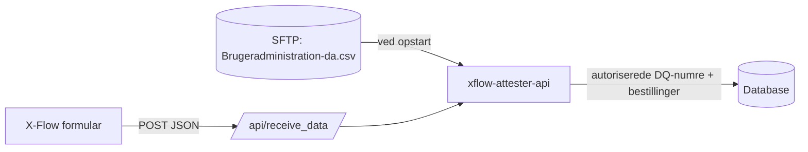

# xflow-attester-api
[**Formål**](#formål) | [**Beskrivelse**](#beskrivelse) | [**Features**](#features) | [**Afhængigheder**](#afh%C3%A6ngigheder)

# Formål

API der modtager attestbestillinger (straffeattest, børneattest m.fl.) fra X-Flow, validerer dem, kontrollerer at rekvirenten er leder/stedfortræder og gemmer bestillingen i databasen.

## Beskrivelse



1. **Ved opstart** hentes `/Brugeradministration-da.csv` (semikolon-separeret, UTF-16) fra SFTP. DQ-numre med rollen *Leder* eller *Stedfortræder for leder* gemmes i tabellen `authorized_sagsbehandlere` (listen erstattes hver gang). Kan SFTP ikke nås, starter app'en ikke.
2. **Ved modtagelse** valideres JSON, rekvirentens DQ-nummer slås op, og der oprettes **én række pr. bestilt attestType** i `attestation_requests`.
3. Bestillinger fra ikke-autoriserede rekvirenter gemmes også, men med `erGodkendt = false` og `erSendtTilManuelBehandling = true`.

> Data indeholder CPR-numre (personfølsomme oplysninger). Brug aldrig produktionsdata i test, og log ikke payloads.

## Features

| Metode | Sti | Beskrivelse |
|---|---|---|
| POST | `/api/receive_data` | Modtager bestilling fra X-Flow |
| GET | `/healthz` | Health check – returnerer `{"status": "ok"}` |
| GET | `/metrics` | Prometheus metrics (bl.a. `http_server_errors_total`) |

### POST /api/receive_data

```json
{
    "sagsbehandler": "Fornavn Efternavn - DQ12345",
    "medarbejderCPR": "010190-1234",
    "attestType": "0, 1, 2",
    "attestSubType": [
        {"attestType": 0, "subType": 1},
        {"attestType": 2, "subType": 3}
    ],
    "samtykke": true
}
```

Valideringsregler:

* `sagsbehandler`: `Navn - DQ` + præcis 5 cifre.
* `medarbejderCPR`: `DDMMÅÅ-XXXX`.
* `attestType`: `0`, `1` og/eller `2` – int eller kommasepareret string, ingen dubletter.
* `attestSubType`: præcis ét objekt for hver bestilt attestType 0 og 2. AttestType 1 har ingen subtype (`[]` hvis kun 1 er bestilt).
* `samtykke`: boolean.

Svar:

* `200` – `{"status": "data received", "approvalStatus": "approved" | "denied", "requestId": "<uuid>"}`
* `400` – `{"errors": [...]}` ved valideringsfejl
* `503` – database ikke konfigureret

### Tabel `attestation_requests`

Primærnøgle: (`requestId`, `attestType`). Felter: `rekvirentDQ`, `rekvirentNavn`, `rekvisitusCPR`, `attestType`, `attestSubType`, `erGodkendt`, `erBestilt`, `erModtaget`, `erJournaliseret`, `erSendtTilManuelBehandling`, `erAdviseret`, `sbsysSagsNr`, `sbsysSagsID`, `anmodetTS`, `bestiltTS`, `modtagetTS`, `journaliseretTS`, `adviseretTS`.

Tabellerne oprettes automatisk ved opstart.

### Kendte begrænsninger / TODO

* Gyldige subtype-koder er ikke fastlagt endnu (`VALID_SUBTYPES_BY_TYPE` i [attest_validation.py](src/attest_validation.py)).
* Autorisationslisten opdateres kun ved opstart.
* Bekræftelse/afvisning sendes endnu ikke til rekvirenten – kun som HTTP-svar.
* SFTP-serverens host key verificeres ikke.

## Afhængigheder

:cloud: | API'er, FTP-servere, CDN'er andre online services som applikationen kommunikerer med.

* SFTP-server (SFTP-SDRoller) med `Brugeradministration-da.csv`
* Database: MSSQL ([pymssql](https://pypi.org/project/pymssql/)), MariaDB ([PyMySQL](https://pypi.org/project/PyMySQL/)) eller PostgreSQL ([psycopg2](https://pypi.org/project/psycopg2-binary/)) via [SQLAlchemy](https://www.sqlalchemy.org/)

:heavy_dollar_sign: | Miljøvariabler som forventes at være populeret. Secrets ligger i Bitwarden; lokalt lægges de i `.env` (git-ignored, se `.env.example`).

| Variabel | Beskrivelse |
|---|---|
| `FLASK_ENV` | `dev` eller `prod` (default `dev`, som har `DEBUG=True` som default) |
| `DEBUG` | `True`/`False` |
| `PORT` | Port app'en lytter på (default `8080`) |
| `ATTEST_DB_TYPE` | `mssql`, `mariadb` eller `postgresql` (default `mssql`) |
| `ATTEST_DB_HOST` / `ATTEST_DB_PORT` | Database server |
| `ATTEST_DB_NAME` | Databasenavn |
| `ATTEST_DB_USERNAME` / `ATTEST_DB_PASSWORD` | Database login |
| `SFTP_HOST` / `SFTP_USERNAME` | SFTP server |
| `SFTP_PASSWORD` | SFTP kodeord – eller brug nøgle herunder |
| `SFTP_KEY_BASE64` / `SFTP_KEY_PASS` | Base64-kodet SSH nøgle og evt. kodeord (valgfri) |

## Udvikling

<!--
Beskrivelse af hvordan løsningen startes lokalt.
Overblik over eventuelle API endpoints som løsningen udstiller.
Notering af eventuelle hard-codede værdier, og hvordan værdierne kan ændres.
-->

### Lokal udvikling

1) Opret et virtuelt miljø:

    *Linux/macOS*:

    ```bash
    python -m venv .venv
    source .venv/bin/activate
    ```

    *Windows (PowerShell)*:

    ```powershell
    python -m venv .venv
    .\.venv\Scripts\Activate.ps1
    ```

2) Installér dependencies:

    ```bash
    pip install -r requirements.txt -r requirements-dev.txt 
    ```

3) Opret din `.env` (hvis denne mangler)

    Kopiér eksempel-filen, og redigér værdier efter behov.

    ```bash
    cp .env.example .env
    ```

    Bemærk:

    - `.env` ignoreres af git.
    - Hvis du tilføjer nye miljøvariabler, skal du også tilføje dem i `src/utils/config.py`.

4) Kør applikationen:

    ```bash
    python src/main.py
    ```

### Docker (gunicorn)

Applikationen benytter Docker via `Dockerfile`, som kører applikationen med gunicorn.

Byg og kør applikationen:

```bash
docker build -t xflow_attester_api:local .
docker run --rm -p 8080:8080 -e FLASK_ENV=prod -e PORT=8080 xflow_attester_api:local
```

Kør applikationen med compose:

```bash
docker compose up --build
```

Compose starter også en lokal Postgres (kun testdata) og læser `SFTP_*` fra `.env`:

* Forbind fra egen PC: `localhost:5433`, bruger `user` / `pass`, database `attester_db`
* Data bevares mellem genstarter. Ryd databasen med `docker compose down -v`

### Formatering, linting, test

Organisér imports med iSort:

```bash
isort .
```

Formatér kode, så den overholder PEP 8 med Autopep8:

```bash
autopep8 .
```

Kør linting med Flake8:

```bash
flake8
```

Kør tests med Pytest:

```bash
pytest
```